# From the plan to the dashboard, end to end

[`workflow.md`](workflow.md) draws who does what and [`architecture.md`](architecture.md) the parts
underneath. This page draws both as one system: how a line of `plan.md` becomes code on `main`
(stages A to F), and how what happened on the way is collected, measured and shown (stages 1 to 8).
Where it disagrees with [`CLAUDE.md`](../CLAUDE.md), [`specs/README.md`](../specs/README.md) or the
code, they win.

The thick arrows are the loop that makes it one system: a merge lands on `main`, the pipeline
measures it, and the dashboard and `spec-drift.json` tell the maintainer or the driver the next step.

```mermaid
flowchart LR
    subgraph WA["A. DIRECTION — Who starts a step and who merges"]
        direction TB
        HUMAN["Maintainer<br/>Writes plan.md · Decides scope<br/>Says start Day N and merged"]
        DRVR["Driver, run-steps.py, opt-in<br/>Reads the next step · Starts one claude -p session per step<br/>Waits for the checks · Merges at level 2, or parks"]
        STEP["Step session, a fresh one per step<br/>Specs · Briefs · Review · Commits<br/>One PR, then it stops"]
        GUARDS["Hooks and guards<br/>step-guard · read-guard · auditor-guard<br/>cap-output · session-size"]
        HUMAN -->|"manual mode"| STEP
        DRVR -->|"driver mode"| STEP
        GUARDS -.->|"refuse"| STEP
    end

    subgraph WB["B. PLAN — The goal"]
        direction TB
        PLANMD["plan.md<br/>Phases · Stopping points · Commitments"]
        PAUD["plan-auditor<br/>First day of a phase, and at its end<br/>Plan against specs against code"]
        PCHG["Plan-change PR<br/>Only when the code shows the plan is wrong"]
        PLANMD --> PAUD
        PAUD -.-> PCHG
        PCHG -.-> PLANMD
    end

    subgraph WC["C. SPECIFY — One day's promises"]
        direction TB
        SPEC["Day spec<br/>Criteria tagged new or hold<br/>Each with a Plan: line"]
        SAUD["spec-auditor<br/>Runs every check on today's code<br/>Tries to break every hold"]
        SCHG["Spec-change PR<br/>The auditor rechecks the fixes"]
        SPEC --> SAUD --> SCHG
    end

    subgraph WD["D. BUILD — One PR per track, from fresh main"]
        direction TB
        BRIEF["Brief, written by the step session<br/>brief-check.py"]
        TRB["track-reviewer on the brief<br/>Callers · Fakes · Expected counts"]
        RED["implementer writes the tests<br/>seen-red.py: red for the stated reason"]
        IMPL["implementer writes the code<br/>Never commits or pushes"]
        TRD["track-reviewer on the diff<br/>Each claim of the PR against the diff"]
        SHIP["Step session<br/>Reads the diff · break.py on each check<br/>pre-push.py · Commits · Opens the PR"]
        BRIEF --> TRB --> RED --> IMPL --> TRD --> SHIP
    end

    subgraph WE["E. GATE — Pull request to main"]
        direction TB
        CI["CI checks on the pull request<br/>Tests · Style · Template · Diff size · Names<br/>Frozen files · Seen red · Breaks replay · Plan links"]
        DREV["Driver's reviewer, driver mode only<br/>Fresh session, read-only<br/>rules/reviewer.md"]
        MERGE["Merge<br/>The maintainer, or the driver at level 2<br/>Never a session"]
        PARK["Park<br/>An issue for the maintainer<br/>Red twice · A blocker · plan.md or a human-only file"]
        CI --> DREV --> MERGE
        CI --> MERGE
        CI -.-> PARK
        DREV -.-> PARK
    end

    subgraph WF["F. CLOSE — Prove the day and record it"]
        direction TB
        CLOSE["Closing PR<br/>Criteria ticked with evidence<br/>Notes with Defect lines · Lab notebook · Break manifest"]
        EVY["evidence.yml<br/>Replays the closed day on main"]
        RATER["defect-rater, at a phase's last close<br/>Relabels the defects blind"]
        PHEND["Phase end<br/>plan-auditor · Phase table · Outside review<br/>Three more auditors after Phase 3"]
        CLOSE --> EVY --> PHEND
        RATER -.-> CLOSE
    end

    subgraph S1["1. SOURCE — Where facts are created"]
        direction TB
        GIT["Git / main branch<br/>Plan · Specs · Breaks<br/>Code · Tests · Config<br/>The code on main is what ships"]
        GH["GitHub<br/>Pull requests · Workflow runs<br/>Parked issues"]
        LOCAL["Maintainer's machine<br/>Claude transcripts<br/>Refusal logs · Driver logs"]
        DOCS["Hand-maintained dashboard data<br/>User stories · Promises · File stations"]
    end

    subgraph S2["2. COLLECTION — Gather missing evidence"]
        direction TB
        HOOKS["SessionStart / SessionEnd hooks"]
        TOKEN["token-usage.py"]
        DRIVER["driver-runs.py"]
        RECHECK["recheck.yml<br/>Replay historical breaks"]
        PUBLISH["publish-counts.py --put"]
        HOOKS --> TOKEN
        HOOKS --> DRIVER
        RECHECK --> PUBLISH
    end

    subgraph S3["3. DATA STORE — dashboard-data branch"]
        direction TB
        DATA["token-usage.json<br/>gates.json · sessions.json<br/>refusals.json · counted.json"]
        DRDATA["driver-runs.json"]
        HISTORY["replay-history.json"]
    end

    subgraph S4["4. BUILD — dashboard.yml"]
        direction TB
        TRIGGER["Build triggers<br/>Main merge · Publisher dispatch<br/>Infrastructure checks"]
        EVIDENCE["close-evidence.py<br/>Recheck closed-day evidence"]
        READERS["Spec-drift readers<br/>Git · GitHub · Specs<br/>Handoffs · Data · Evidence"]
        METRICS["Metrics engine<br/>Clock · Chance bands<br/>Code names · Yardsticks"]
        VIEWS["View generators<br/>Plan · Files · Score<br/>Other dashboard sections"]
        PAGE["spec_drift_page<br/>Complete HTML<br/>CSS + JS + embedded data"]
        CACHE["Build caches<br/>Spec-drift cache<br/>Evidence cache"]
        TRIGGER --> EVIDENCE --> READERS
        READERS --> METRICS --> VIEWS --> PAGE
        CACHE -.-> EVIDENCE
        CACHE -.-> READERS
    end

    subgraph S5["5. PUBLISH — GitHub Pages"]
        direction TB
        SITE["site/index.html"]
        DEPLOY["Deploy job"]
        SITE --> DEPLOY
    end

    subgraph S6["6. DASHBOARD — docs/dashboard/"]
        direction TB
        TEMPLATE["index.html + dashboard.css"]
        JS["dashboard.js<br/>Renders views from SPEC_DRIFT<br/>Does not calculate metrics"]
        PUBLIC["Published dashboard"]
    end

    subgraph S7["7. CONSUMERS — Who uses the evidence"]
        direction TB
        MAINT["Maintainer<br/>Reads public dashboard"]
        AUDIT["Instrument auditor<br/>Independently recounts Git and GitHub"]
        JSON["Local spec-drift.json<br/>53 keys · Next-step recommendation"]
        TOOLS["Analysis tools<br/>Phase table · Reconciliation<br/>Plan auditor · End-of-phase auditors"]
        JSON --> TOOLS
    end

    subgraph S8["8. QUALITY CONTROL — Pipeline verification"]
        direction TB
        TESTS["spec-drift-tests.yml<br/>Pull request tests"]
        DEMO["demo-data.py<br/>Synthetic data through real views"]
        LIB["Reusable library consumers<br/>close-views · behaviour-index<br/>replay-history · token-usage"]
    end

    HUMAN -->|"writes"| PLANMD
    STEP -->|"one step per session"| SPEC
    PAUD --> SPEC
    SCHG --> BRIEF
    SHIP --> CI
    MERGE -->|"next track"| BRIEF
    MERGE -->|"last track merged"| CLOSE
    CLOSE -->|"a PR like any other"| CI
    PHEND -.->|"what the next phase must know"| PLANMD
    PARK -.->|"waits for an answer"| HUMAN

    MERGE ==>|"lands on main"| GIT
    SHIP --> GH
    CI --> GH
    PARK --> GH
    STEP --> LOCAL
    GUARDS --> LOCAL
    DRVR --> LOCAL

    GIT --> RECHECK
    GIT --> EVIDENCE
    GH --> READERS
    GIT --> READERS
    DOCS --> READERS
    LOCAL --> TOKEN
    LOCAL --> DRIVER

    TOKEN --> DATA
    DRIVER --> DRDATA
    PUBLISH --> HISTORY

    DATA --> READERS
    DRDATA --> READERS
    HISTORY --> READERS

    HOOKS -.-> TRIGGER
    PUBLISH -.-> TRIGGER

    TEMPLATE --> PAGE
    JS --> PAGE
    PAGE --> SITE
    DEPLOY --> PUBLIC
    PUBLIC --> MAINT
    PUBLIC --> AUDIT
    AUDIT -.-> MAINT
    VIEWS -.->|"Manual --out export"| JSON

    MAINT ==>|"decides the next step"| HUMAN
    JSON ==>|"next step"| DRVR
    JSON -.->|"next step"| STEP

    TESTS -.-> READERS
    TESTS -.-> VIEWS
    DEMO -.-> VIEWS
    LIB -.-> READERS

    style WA fill:#fef2f2,stroke:#dc2626,color:#7f1d1d
    style WB fill:#eef2ff,stroke:#4f46e5,color:#312e81
    style WC fill:#ecfeff,stroke:#0891b2,color:#164e63
    style WD fill:#f0fdf4,stroke:#15803d,color:#14532d
    style WE fill:#fffbeb,stroke:#b45309,color:#78350f
    style WF fill:#faf5ff,stroke:#7e22ce,color:#581c87
    style S1 fill:#e8f0fe,stroke:#4285f4,color:#172554
    style S2 fill:#fff7ed,stroke:#ea580c,color:#7c2d12
    style S3 fill:#f3e8ff,stroke:#9333ea,color:#581c87
    style S4 fill:#ecfdf5,stroke:#059669,color:#064e3b
    style S5 fill:#fef3c7,stroke:#d97706,color:#78350f
    style S6 fill:#dcfce7,stroke:#16a34a,color:#14532d
    style S7 fill:#f1f5f9,stroke:#64748b,color:#334155
    style S8 fill:#fce7f3,stroke:#db2777,color:#831843
```

## What the picture does not say

- **Two modes.** The driver's reviewer and the driver's merge belong to driver mode. This
  repository's own Days run in manual mode, where the maintainer merges; the driver has run on
  bearing (`plan.md`, "Two modes, one workflow").
- **The checks are named, not all confirmed as required.** The names in stage E come from the
  workflow files in `.github/workflows/`. Which of them `main` requires is set on GitHub, and was
  not read when this was drawn.
- **The infrastructure trigger never fires here.** `dashboard.yml` also rebuilds after a workflow
  named "Infra checks"; its own comment says a repository without one never starts it.
- **Not drawn:** which key of the data each graph in `dashboard.js` reads, and `track-breaks.yml`,
  which replays a track's breaks on its pull request and is one of the checks in stage E.

Drawn on 27 November 2026 from the workflows, `.claude/settings.json`, `scripts/publish-counts.py`,
the `spec_drift_*.py` modules, `plan.md` and the driver's modules, at `273fd18`. The modules have
moved since: stage 4's readers, metrics, views and page are in `scripts/pipeline/` (`sources/`,
`counts/`, `build/`; [`scripts/README.md`](../scripts/README.md) says what each one does), and all
but three of the scripts' tests are in `scripts/tests/`. The folders sort two modules otherwise
than stage 4's boxes do: the plan graph and the file map, drawn among the views, sit in `sources/`.
