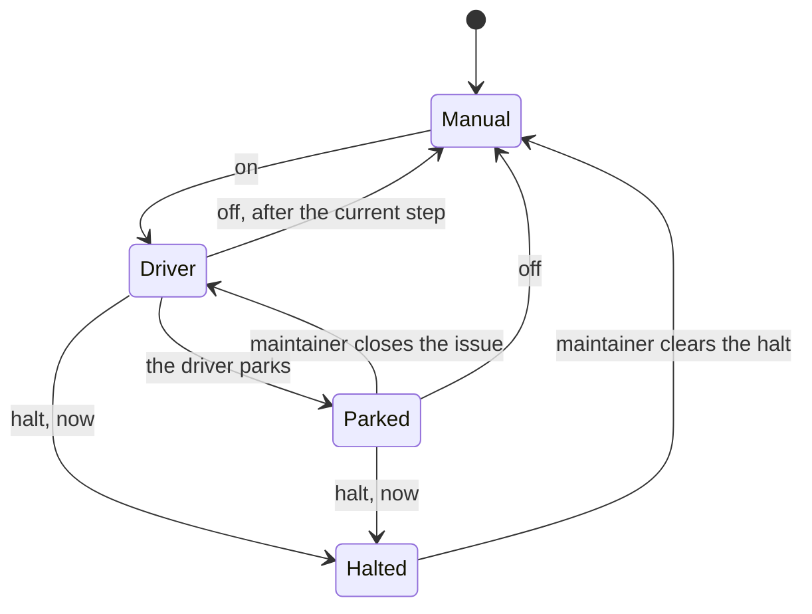
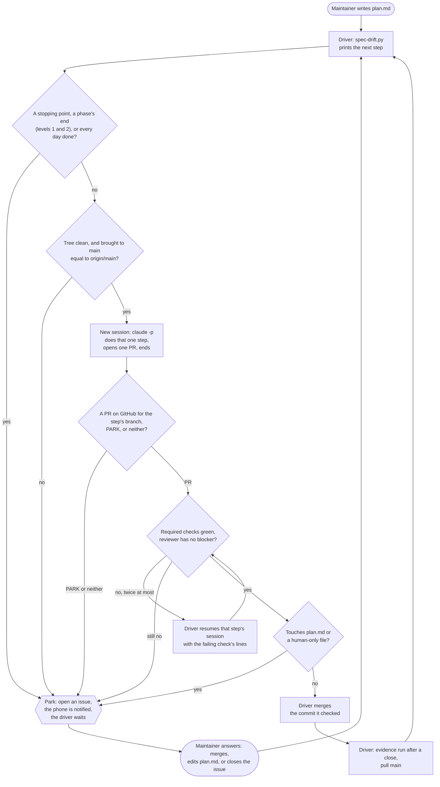
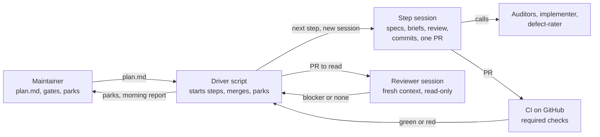

# agentic-workflow-driver plan: a driver runs the days, the maintainer owns the plan

<!-- plan.md says what and why; the day specs in specs/ say how. It changes only in a
plan-change PR. -->

Written 2026-11-06 in the [kit](https://github.com/Yusuprozimemet/agentic-workflow-kit) as
`kit/automation-plan.md`, and moved here when this repository was set up from the kit at
`393dda6`. It replaces the plan the kit reverted in `de61820` (its PR #104): no container, no GitHub
App, no CODEOWNERS. One script on a PC that stays on, and GitHub on the phone. The script has a
repository of its own ("Where the driver lives"); the kit is not changed for it.

## Short answer

**Can the human leave the loop?** The day loop, yes. Four things, no.

The day loop is already mechanical: `scripts/spec-drift.py` prints the next step, the agents do
it, CI judges it. What the maintainer does inside it today is type "start Day N", press merge,
type "merged" and open a new session. A script can do all four.

What stays with the maintainer:

1. **`plan.md`**: writing it, changing it, and lifting each stopping point it names.
2. **The gates**: CI, hooks, `CLAUDE.md`, the scripts, branch protection. An agent that merges
   its own work and can edit the checks has no checks.
3. **Everything outside the repository**: accounts, tokens, secrets, spending limits, deploys,
   anything that destroys a resource.
4. **Parks**: a step the agent could not finish or would not decide.

So the human moves from every pull request to the plan, the parks and a report. That is out of
the loop, not out of the responsibility.

**Can an agent start a new session by itself?** Not from inside a session, and it does not need
to. Each `claude -p "<prompt>"` call is a new session with an empty context. A driver script that
calls it once per step gives "one session per step" for free, and `scripts/step-guard.py` never
fires because nobody types "merged".

## Two modes, one workflow

The driver is a second way to run the same workflow, not a replacement. With the driver not
running, everything works as today: the maintainer starts each step, merges and says "merged".

| | Manual mode (today) | Driver mode (opt-in) |
|---|---|---|
| Started by | "start Day N" in a session | `python run-steps.py on` |
| Who plays the maintainer inside a day | the maintainer | the driver |
| Rules a session follows | `CLAUDE.md` | the same `CLAUDE.md`, plus the `PARK:` line |
| Merge | the maintainer | the driver (level 2), never a session |
| After a merge | a new session, or `/compact` | always a new session |
| step-guard, the other hooks, CI | as today | as today |

- A step session does the same work in both modes: one step, one PR, then it stops. Only who
  starts it and who merges differ.
- What the driver adds applies only to sessions it starts (it passes its hooks and rules to each
  one from its own folder): the
  merge refusal, the `PARK:` line, lessons as a hand-off. A manual session sees none of it.
- The state is in git and on GitHub, so the mode can change at any step boundary: stop the
  driver and go on by hand, or start it in the middle of a day. A park is exactly that switch.
- Never both at once on one repository: the driver holds a lock file while it runs and refuses
  to start while a manual session's branch is unmerged.
- One thing changes manual mode too, on a project that goes to level 2: `main` there requires a
  pull request and allows no bypass ("Decisions for the maintainer"). Manual mode already merges
  only by PR.

## Where the driver lives

Decided 2026-11-06: the driver has a repository of its own. The kit stays the source of the
workflow's rules, and the driver holds none of them. It reads the order of a day from the
project's `CLAUDE.md` and the next step from the project's `scripts/spec-drift.py`, and adds only
what an unattended run needs: the switches, the parks, the merge.

- **The driver's repository is a project like bearing**: set up from the kit, with this document
  as the base of its `plan.md`, built by hand one day spec at a time. The driver never drives its
  own repository.
- **A project needs no change to be driven.** The driver passes its hooks with
  `claude --settings <its file>` and its rules with `--append-system-prompt-file`, both from its
  own folder. Nothing of the driver is in a project's `.claude/`, so a manual session never loads
  any of it.
- **Its hooks are named by absolute path.** In a session the driver starts,
  `CLAUDE_PROJECT_DIR` is the project's folder, not the driver's, so a hook command cannot find
  the driver's scripts through it. Before each session the driver writes its settings file into
  its own state folder, uncommitted and ignored by git, with each hook's script and the halt file
  named in full; the check of its own repository ("What the separate folder protects") does not
  see it, and the next session's file is written afresh.
- **Checked on Claude Code 2.1.170** (2026-11-06, `claude -p` in a scratch project with a hook
  of its own): hooks from `--settings` are added to the project's, not put in their place. Both
  fired on the same call, with the same event and matcher, and inside a subagent. A `--settings`
  hook that exits 2 while a halt file exists refused the call, and the command did not run.
  `--strict-mcp-config` was accepted without a config, and a session started with `--agent`
  gave its hooks the agent's name. Repeated on 2.1.322 (`live-check`) before the Day 8 trial,
  which ran on that version.
- **The driver does depend on the kit**: on the sentence `next_step()` returns, the `--out`
  JSON, the branch names and more. "What the driver needs from the kit" lists them, and what
  happens on a project whose kit says them differently.

**What the separate folder protects, and what it does not.**

- It keeps the driver out of the project's pull requests and out of the tree a step session
  works in. No PR can change it, and neither can a checkout or an uncommitted edit in the project.
- It does not keep a session out. A step session runs under the same Windows account as the
  driver, and that account can write the driver's script, its settings file and hooks, the halt
  file and the run log, and can read the stored token. A hook limits the tools; it does not
  change what the account may do.
- **Level 1 refuses and detects; it does not prevent.** A hook from the driver's settings
  refuses Edit and Write under the driver's folder and a shell command that names it. Like
  `auditor-guard.py` it reads the command, not what a program does. Before each step, and at
  level 2 before each merge, the driver checks that its own repository is clean and at the commit
  it started from, and halts on a difference. A session that changed a hook had that hook off for
  the rest of its own run; the check finds it afterwards.

What would prevent it:

| Isolation | What it stops | What it costs |
|---|---|---|
| A second Windows account for the sessions: a standard user with read and execute but no write on the driver's folder (`icacls`), and write only on the project's checkout | edits to the driver, its hooks and the halt file; reading the maintainer's other files and logins | that account's own Claude and `gh` logins; the driver starts each session as another user and must be able to kill it |
| A container or VM with only the project's checkout inside, the driver outside | the same, and everything else on the PC | the setup of the dropped plan |

Neither stops a session from using the token it holds ("What this does not stop"). Which one,
and when, is in "Decisions for the maintainer": the container, chosen 2026-11-11 ("Course
corrections"). Docker Desktop was already on the PC, so most of that row's cost was paid.

**The session's container.** At level 2, and at level 1 when `driver.json` asks for it, the
driver runs each session's `claude -p` with `docker run -i --rm --name <a name from the session's
id>`, from an image the driver's repository builds (Claude Code at the live-checked version,
Python, git, `gh`). The step still goes in on standard input and the JSON result comes out on
standard output. What the session can reach is what the driver mounts:

- the project's checkout, writable: the one tree a step edits;
- the driver's hooks, its rules and the settings file it wrote, and the state folder with the
  halt file, read-only: Docker refuses a write there, not a hook;
- `<state>/refusals`, writable, for the hooks' log (Day 9);
- a Claude Code folder of the driver's state, writable, as the session's `CLAUDE_CONFIG_DIR`: its
  transcripts, which the usage limit and the cost are read from;
- the fine-grained token as `GH_TOKEN`, and a Claude Code token for a headless login, from a file
  the maintainer keeps outside both repositories. None of the maintainer's own logins or files.

The driver kills a session with `docker kill`, and `halt` kills the container the run log names
as well as the driver: killing the driver, or the `docker` client it started, leaves the
container running. The driver itself stays on the PC, under the maintainer's account, with the
maintainer's `gh` login: it polls, and at level 2 it merges. The session now runs on Linux, so
the project's tests run there in a step as they do in CI.

The image's system git config (`/etc/gitconfig`) sets `safe.directory` to the mounted checkout,
`core.autocrlf` true and `core.filemode` false. Without them git in the container refuses the
checkout ("detected dubious ownership": the mount's files are owned by root), and with
`safe.directory` alone it reads every file of a Windows checkout as changed (CRLF, and every file
mode `777`). `safe.directory` is not read from `GIT_CONFIG_COUNT` variables.

**Shown on 2026-11-11** (Docker Desktop 29.4.3, WSL 2; an image from `node:22-bookworm-slim` with
Claude Code 2.1.322, Python, git and `gh`; a clone of bearing): the step in on standard input and
the output back on standard output through `subprocess`; `claude --version` in the container;
writes refused under a read-only mount ("Read-only file system") for the driver's folder, its
hooks, the halt file and the settings file, while a writable `refusals` folder mounted inside the
read-only state folder takes them; the halt file readable; `docker kill` closing the session's
pipe in under a second with no container left; and, with the git config above, `git status`
clean on the Windows checkout, a commit made in the container storing LF line endings, and the
checkout clean on the PC after it. Not yet shown: "Unverified".

## What the driver needs from the kit

The driver holds no rule of the workflow, but it depends on how the kit says some things, and a
project set up from another version of the kit may say them differently. A project records no
kit version, so there is no number to compare. The driver checks what it needs each time, and
refuses or parks when it is not there.

| The driver relies on | Where the kit has it | On a project that differs |
|---|---|---|
| `python scripts/spec-drift.py --out <file> --cache <file>` writes JSON with `now.next_step`, `now.open_prs`, `order`, and each day's `day`, `phase` and `status` | `scripts/spec-drift.py` | `on` refuses and names the field |
| the sentences `next_step()` returns | `next_step()` in the same script | a sentence the driver does not know is a park, never a guess |
| the branch names `day-NN/spec-<slug>`, `day-NN/track-<x>-<slug>`, `day-NN/close-the-day` | `CLAUDE.md`, `scripts/pr-names.py` | the driver finds no PR and no unfinished branch for the step: a park |
| a step is one pull request, and the session stops once it is open | `CLAUDE.md`, "A day, in order" | a session that goes on passes its budget or opens a second PR: a park |
| the evidence run after a close, `evidence.yml`, on the merge commit | `.github/workflows/evidence.yml`, `CLAUDE.md` step 5 | no run is found: a park |
| the project's hooks run under `claude -p`, and `step-guard.py` acts only on a short "merged" | `.claude/settings.json`, `scripts/step-guard.py` | the driver never sends such a prompt; a hook that refuses a step's work ends it without a PR: a park |
| only the owner's open pull requests reach the next step | `owners_prs()` in `scripts/spec-drift.py` | the driver filters by author itself as well |
| a `Hand-off` line to the maintainer in a day's Notes | `specs/_template.md` | a lesson for `CLAUDE.md` has nowhere to go; the rules file says so |

**What the kit does not say yet.** No rule names the branch of the step "write its day spec".
For now that step stays a manual hand-off: the driver parks on it, and the maintainer writes the
day's spec by hand, as in manual mode. Whether the kit should name a branch for it is left until
the trial shows how often it comes up.

**How it is kept.**

- **A preflight at `on`.** The driver runs the project's `spec-drift.py`, checks the fields
  above, and checks that `scripts/pr-names.py` and `evidence.yml` are there. It refuses to turn
  on with one line for each piece it misses. It does not adapt to an older kit: the project is
  brought up to the kit, by the maintainer.
- **A contract test in the driver's repository.** It calls `next_step()` in the repository's own
  copy of the kit's script for every sentence it can return and checks that each one is known.
  That copy is no longer the kit's file: #134 and #135 split it into `spec-drift.py` and
  `spec_drift_*.py` modules, so a newer kit cannot be dropped in. A newer kit is tested by
  porting the change to its `next_step()` into the split copy and running the test; the driver's
  README names the kit commits the test has passed on, and a trial's record names the commit of
  its project's copy.
- **In a run**: what the driver does not recognise parks.

## The switches

Two switches, both the maintainer's. The first chooses the mode; the second stops driver mode at
once when something looks wrong. The commands run from the driver's folder; its config names the
project.

| Switch | From the PC | From the phone | What happens |
|---|---|---|---|
| Mode: on | `python run-steps.py on` | | the driver takes the next step; refused while a manual branch is unmerged or a halt is set |
| Mode: off | `python run-steps.py off` | close the run's issue | the current step finishes its PR, then the driver exits; nothing new starts |
| Emergency stop | `python run-steps.py halt` | open an issue whose title starts with `STOP` | everything stops now, see below |
| Where am I | `python run-steps.py status` | the run's issue | mode, level, the step in progress, its cost so far |

**What a halt does**, in this order:

1. Writes the halt file, in the driver's folder. From then on a hook refuses every tool call in
   every session the driver started, subagents included. This holds even if a process survives.
2. Kills the running session and everything it started: the whole process tree of the driver
   process the lock names.
3. Merges nothing, starts nothing, and exits. Open pull requests stay open and unmerged.
4. Writes what was in progress to the run's issue: the step, the branch, the last commit, whether
   the working tree was left with uncommitted changes.

- From the PC it takes effect within a second. From the phone it takes as long as the driver's
  poll of GitHub, 30 seconds by default, and only an issue from the maintainer's account counts.
- A halt is sticky. The driver will not start again until the maintainer clears it
  (`run-steps.py clear`), and it comes back in manual mode: turning the driver on again is a
  separate, deliberate step, after looking at what went wrong.
- A halt does not undo. What was already merged stays merged, and what was pushed stays pushed.
  Reverting is the maintainer's decision, by hand, in manual mode.
- The halt file is a plain file: with the driver itself broken, creating it by hand still stops
  the sessions' tool calls.

## The loop

## Sessions and tokens

One step, one session, as in manual mode. The driver never carries a session past its own PR.

| What | Session | Why |
|---|---|---|
| each step: a day's spec, the spec-change PR, each track, the close, an end-of-phase audit | **new** | `CLAUDE.md`, "One session per step" |
| auditors, implementer, defect-rater | subagents of the step's session, each with its own context | as today |
| the reviewer | new, and never the step's session | independence, not tokens |
| a fix after a red check or a reviewer's blocker | the step's own session, resumed (`claude -p --resume <id>`) | it is the same step; in manual mode the waiting session fixes its own PR too |
| waiting for CI, the merge, the evidence check, the dashboard, the next step | none: the driver script | no tokens; in manual mode these are replies that re-read the whole session |

**No compact before a merge.** `/compact` shrinks what the later replies of the same session
re-read. In driver mode the step's session has no later replies: it ended when the PR opened, and
the next step starts from an empty context, which is smaller than any summary. A compact is
itself a reply that reads the whole session to summarise it, so before a merge it would cost that
and save nothing. In manual mode `/compact` is the alternative to a new session after "merged";
the driver always takes the new session.

What the kit has measured, and why nothing more is planned
([six-kits-plan.md](https://github.com/Yusuprozimemet/agentic-workflow-kit/blob/393dda6/kit/six-kits-plan.md),
[CHANGES.md](https://github.com/Yusuprozimemet/agentic-workflow-kit/blob/393dda6/kit/CHANGES.md), in the kit):

- A session starts at about 50k tokens (bearing: median 49,592), mostly Claude Code's own prompt
  and tools; `CLAUDE.md` is about 5.5k of it. Every step pays it once. It is not a lever.
- Restarting inside a piece of work costs more than it saves: a fresh session at 100k read 20.9%
  fewer tokens and cost 4.1% more. So a fix resumes its step's session; it does not start another.
- With one session per step, sessions stay small: on bearing 8.5% of 94 main sessions passed
  150k, the largest was 173,479, and 3.4% of the cost was above 150k. Claude Code compacts by
  itself near the end of the context window; nothing has to ask for it.

## What bearing's record says about the human

Counted on bearing at `2862637`, 84 merged pull requests, re-counted 2026-11-06.

- **156 Defect lines.** Found by: auditor 98, the tracks 18, close 11, self 10, spec-change PR 7,
  review 5, break on purpose 4, dashboard 3. The agents and the checks found almost all of them.
- **97 `human:` lines on 65 pull requests** (#20 to #84): correction 34, none yet 30, kit 17,
  "the maintainer started this step" 9, and seven others.
- The 34 `correction` lines, sorted by what the maintainer did (this document's reading):

| What the maintainer did | Lines | Under automation |
|---|---:|---|
| started or scoped a step | 11 | the driver: the next step `spec-drift.py` prints |
| decided between options (8 of them: which kit flags to mark, #60 and #64) | 12 | a park |
| reported a failure seen after a merge (#48, #49, #66, #78, #84) | 5 | three were failing checks the driver reads itself; two were noticed on the dashboard and need a check |
| corrected wording or a record (#30, #55) | 3 | the reviewer session, or missed |
| steered the session or asked a question | 3 | lost; the report is where it shows |

None of the 34 is the maintainer reading a diff and finding a code defect. The maintainer's work
was decisions and noticing what the dashboard showed. That is a lower bound: a catch made in chat
before the PR opened may have left no line.

## Who does what

| Work | Today | Under automation | Enforced by |
|---|---|---|---|
| Write `plan.md` | maintainer | **maintainer** | human-only file |
| Change `plan.md`, add a course correction, lift a stopping point | maintainer merges a plan-change PR | **maintainer**: the agent opens the PR, the driver parks it | human-only file |
| Say "start Day N" | maintainer | driver, from `spec-drift.py`'s next step | |
| Write a day's spec from its plan item | main session | step session, once the kit names the step's branch; until then a park | spec-auditor, "Criteria keep their wording" |
| plan-auditor, spec-auditor | subagents | subagents, unchanged | `scripts/auditor-guard.py` |
| Decide which findings become a spec-change PR | maintainer's call | step session; a finding that needs `plan.md` parks | |
| Spec-change PR | main session, maintainer merges | step session, driver merges | required checks |
| Track PR: brief, implementer, diff review, checks, seen red, break on purpose | main session and implementer | unchanged | "Track tests seen red", the diff limit |
| Read the PR before the merge | maintainer | reviewer session, fresh context | its `found:` lines, counted like any gate |
| Merge | maintainer | driver, never a step session | branch protection, a hook |
| Say "merged", refresh the dashboard, report the next step | maintainer and session | driver | |
| Check the evidence run after a close | session, step 5 | driver: `gh run list`, `gh run view --exit-status` | a failed, missing or pending run parks |
| Start a new session | maintainer | driver: each `claude -p` call is one | |
| Closing PR: ticks, Notes, lab notebook, `token-usage.py`, blind relabel, break manifest, rehearsal | main session | step session, on the same PC (the transcripts are local) | "A closed day's evidence replays" |
| Decide each relabel disagreement | main session, maintainer reads it | step session; the report lists them | |
| End of a phase: plan-auditor on both phases | session reports, maintainer says go | runs by itself; **parks with the report** until level 3 | |
| A stopping point `plan.md` names | maintainer | **maintainer**, always | `spec-drift.py` holds the next step |
| End of the last phase: the three auditors | session reports | run by themselves; **the maintainer reads them** | |
| "Stop and ask": a frozen file, a criterion that cannot be met | maintainer | **park** | "Frozen files stay unedited" |
| An `Oversized:` line | maintainer accepts it | **park**: the agent would be waiving its own limit | driver reads the PR body |
| A lesson for `CLAUDE.md` | session edits it | a `Hand-off` line to the maintainer in the Notes; **the maintainer lands it** | human-only file |
| Kit and gate changes: `.github/`, `.claude/`, `scripts/`, `CLAUDE.md`, `AGENTS.md`, `specs/README.md`, the templates, `spec-drift.config.json` | maintainer merges | **maintainer** | human-only files |
| Repository settings, tokens, secrets, spending limit | maintainer | **maintainer** | not in the repository |
| `maintainer action:` hand-offs, deploys, destroying anything | maintainer | **maintainer** | |
| Force-push | maintainer's OK | never | hook |

## When the driver parks

A park opens an issue labelled `parked` with the reason and stops the run. GitHub's phone app
shows it. The driver resumes when the maintainer's account closes the issue.

- The step session's last line is `PARK: <reason>`.
- The pull request touches `plan.md` or a human-only file, or carries `Oversized:`.
- A required check is still red, or the reviewer still has a blocker, after two fixes.
- The evidence run after a close failed, is missing, or did not finish.
- The next step is a stopping point, the end of a phase (levels 1 and 2), or "Every day is done."
- A step passed its budget, or the same step failed twice.
- The session ended with neither a pull request nor `PARK:`: a crash, a question, a stop half-way.
  The driver looks for the PR on GitHub by the step's branch, not in the session's text, and never
  hands a half-done branch to a new session.
- Before a step, the working tree is not clean, or a clean one cannot be brought to `main`
  equal to `origin/main` by a switch and a fast-forward ("Recovery").
- The day's audit found nothing, so no spec-change PR opens: `spec-drift.py` goes on printing
  that step until a `day-NN/spec-*` PR exists, in manual mode too. Decided 2026-11-06: it parks,
  and the run log counts how often. How often is not known: `specs/README.md` says how a
  spec-change PR lists an empty report ("Auditor findings: none"), not that an audit with no
  findings opens one. A day whose criteria are all `new` and whose audit finds nothing has no
  reason for a spec-change PR, so this park may be common.
- A permission refusal stopped the step. The run log counts them; the driver never changes the
  permission mode ("Decisions for the maintainer").
- The next step is "write its day spec": a manual hand-off for now; the maintainer writes the
  spec ("What the driver needs from the kit").
- The usage limit is reached: the driver waits and retries, and parks only if that fails. Not
  built at Phase 1's end (C08.15 is not met): such a session parks as one that ended with neither
  a pull request nor `PARK:`. Day 9 builds the wait.

To answer a park that needs a conversation, open VS Code on that PC and work as today. Level 0
stays available.

## Recovery: after a park, a crash or a restart

A restart must never start a second session for a step that has one, open a second pull request
for it, or discard work nobody finished.

**Where the state is.** Git and GitHub hold what happened: the branches, the pull requests, the
merges, the `parked` and `STOP` issues. The run log holds only what they cannot: a step's session
id, how many fixes it has had, the driver's lock. The driver decides from git and GitHub first.
A lost or torn log makes it park, not guess.

1. **Write before acting.** Before a session starts, the driver appends the step, its branch
   prefix and the session id it chose (`--session-id`) to the run log, and flushes the line. A
   crash at any later moment leaves a line that says a session may exist.
2. **One driver.** The lock names the driver's process and when it started. A second `on`
   refuses while that process lives. A lock whose process is gone is taken over only after the
   table below.
3. **Every start is the same start.** `on`, a restart after a crash or a reboot, and the answer
   to a park all read the table below from the top. Nothing is carried over but the run log.
4. **A step has one session.** A fix resumes it (`--resume <id>`); nothing starts a second one
   while a branch of the step exists. After a crash the driver resumes nothing by itself: the
   step parks with its session id, and the maintainer resumes it by hand or not. The count of
   fixes is in the log; when the log cannot say, both count as used.
5. **The driver opens no pull request and closes none.** Sessions open them, and the driver
   finds them by branch. An open PR on a branch of the step means the step reached its PR: the
   driver waits on it and starts nothing.
6. **One park per reason.** Before it opens a `parked` issue the driver looks for an open one
   for the same step and reason, and comments there.
7. **No command that can lose work.** The driver's git commands are `status`, `rev-parse`,
   `for-each-ref`, `ls-remote`, `fetch`, and on a clean tree `switch main` and
   `merge --ff-only`; `symbolic-ref` and `ls-remote --get-url` read only. Never `reset`, a checkout of a path, `clean`, `stash`, `branch -D`, a
   forced push or the deletion of a branch. A halt kills processes and deletes nothing. What a
   crash left in the tree stays until the maintainer decides.
8. **A merge is asked of GitHub, not of the log** (level 2). Whether a PR merged is read from
   GitHub, and `--match-head-commit` makes a repeated merge refuse.
9. **It does not start by itself.** After a reboot the driver stays off until the maintainer
   runs `on`.

What the driver finds at a start, and what it does. The first row that applies:

| It finds | It does |
|---|---|
| the halt file, or an open `STOP` issue from the maintainer | nothing: it stays halted until `clear` |
| a live process of a session the log names | starts nothing; when the process ends, reads this table again |
| an open `parked` issue of its own | waits for the maintainer to close it |
| an open pull request from the maintainer's account | waits on its checks and its merge; no session |
| uncommitted changes in the project | parks with the paths, the branch, the last commit and the session id |
| a branch of the next step, local or on the remote, with no pull request | parks the same way: unfinished work |
| a clean tree on another branch | `git switch main`, `git merge --ff-only origin/main`; parks if either refuses |
| a clean tree on `main` equal to `origin/main`, and no branch of the next step | starts the step |

Closing a park's issue is the maintainer's "go on", not an instruction. If the maintainer
finished the step by hand, the next step follows. If they deleted its branch, the step starts
again in a new session, which is right: nothing of the first is left. If the branch is still
there, the driver parks again.

## Levels

Autonomy is earned one level at a time, and lost the same way.

| Level | The maintainer | The driver | Enter when |
|---|---|---|---|
| 0, today | starts each step, merges, says "merged", opens the session | | |
| 1, you merge | merges each PR from the phone; answers parks | starts each step in a new session, watches the checks, checks evidence, finds the next step | the driver exists and its `--dry-run` names the step `spec-drift.py` prints, and a phase's end where the days' phases show one; sessions in `auto` mode; a token scoped to the trial's repository |
| 2, the driver merges | answers parks; reads the morning report; samples PRs at each phase end | also merges a PR that passes every gate and touches no human-only file | 15 PRs in a row merged at level 1 without the maintainer asking for a change; the sessions in the driver's container; `main` requires a pull request and allows no bypass |
| 3, phases chain | answers parks; acts at the plan's stopping points | also starts the next phase when the plan-auditor names no plan change | one whole phase at level 2 with no escape |

**Back one level** on an escape: a Defect line found at `close`, by the `dashboard` or in a
`Day NN review`, or a failed evidence replay after a merge. These are counts the kit already keeps.

Level 1 runs one PR per tap, so it is a trial, not the goal. Level 2 is "write the plan, the
agents work, stop only for the plan".

## What it is judged against

From the kit's [Cost baseline for automation](https://github.com/Yusuprozimemet/agentic-workflow-kit/blob/393dda6/kit/six-kits-plan.md#cost-baseline-for-automation): **$1.86 per
merged pull request** and **34.4 replies per merged pull request**, main sessions only (bearing,
84 PRs). An unattended run should not raise either, with the reviewer session counted in. Beside
them: escapes per day, parks by reason, and the refusals: the run log's, and this repository's
in `refusals.json` on the `dashboard-data` branch.

## What to build

In the driver's repository, by its own `plan.md` and day specs. Level 1 first: nothing of level 2
is built until the trial at level 1 has been read.

**Level 1**

1. **The repository.** Set up from the kit as a project. Its first test repeats the `--settings`
   check of "Where the driver lives" on the installed CLI, so an update that changes how settings
   merge fails a test and not a run.
2. **`run-steps.py` and its switches**: `on`, `off`, `status`, `halt`, `clear`; `--dry-run`
   prints the step and starts nothing; `--once` does one step. Its config names the project's
   path, the human-only paths, the budget per step and the steps per night. For each step it:
   - checks its own repository (clean, at the commit it started from) and the project's tree
     (clean, on `main`, `main` equal to `origin/main`; a clean tree elsewhere it brings there
     by a switch and a fast-forward, "Recovery"). The hooks and `spec-drift.py` run from
     the tree the sessions edit, and a path check sees only a PR's diff;
   - reads the project's `spec-drift.py --out` JSON, not only the sentence it prints: the next
     step, and each day's `phase`, since the sentence never names a phase's end or the audit
     that follows it;
   - runs, in the project's folder, with the step on standard input, `claude -p --model <the main session's>
     --output-format json --max-budget-usd <n> --permission-mode auto --strict-mcp-config
     --settings <the driver's>
     --append-system-prompt-file <the driver's rules>`. `--strict-mcp-config` is there so that no
     connector of the maintainer's claude.ai account loads in a session nobody watches;
   - writes the step, its branch prefix and the session's id (`--session-id`) to the run log
     before the session starts ("Recovery");
   - finds the step's PR on GitHub by its branch, not in the session's text;
   - polls the required checks (`gh pr checks <n> --required`) every `--poll` seconds, as Day 6
     built it in place of `--watch`. On a red check it resumes that step's session
     (`--resume`, the id from the JSON output) with the failing lines, filtered and capped, twice
     at most;
   - waits for the maintainer's merge, checks the evidence run after a close, pulls `main`.

   It acts only on pull requests the maintainer's account opened, and puts no PR title or body
   into a prompt (a project may be public; anyone can open one).
3. **The driver's settings and rules.** The settings: the halt hook (every tool call, refused
   while the halt file exists), the refusal of `gh pr merge` and of a push to `main`, the refusal
   of edits to the driver's folder. The rules: the `PARK:` line, and a lesson for `CLAUDE.md`
   written as a `Hand-off` line. No driver without its stop: a test starts a step, halts, and
   checks the process is gone and a tool call is refused (Day 3 on a stand-in process, Day 4 on
   a real step).
4. **Parks**: the `parked` issue, every reason in "When the driver parks", and the phone's `STOP`
   issue.
5. **The run log**: one line per step, printed by `status`: steps, parks by reason, cost per PR
   beside the baseline.

Then the trial: one day at level 1, in a project that is neither the kit nor the driver's own
repository.

**After the trial, if the driver stays**

6. **The reviewer.** Its brief is in the driver's repository and reaches the session with
   `--agents` and `--agent`; the kit's `auditor-guard.py` does not list it. The driver's settings
   refuse it a git command that changes a repository and a `gh` command that is not a read. The
   driver takes HEAD, the refs, the stash and `git status` before and after it and parks on a
   difference: `auditor-guard.py` makes that comparison at `SubagentStop`, which a top-level
   session does not fire.
7. **The level 2 merge**: the path check against the human-only list, then
   `gh pr merge --match-head-commit <sha>`, the commit the checks and the reviewer saw.
8. **Level 3**: the next phase starts when the plan-auditor names no plan change.

**In the kit**, as ordinary `tooling/` pull requests. Each serves manual mode, and the driver
runs without them:

- A check that the dashboard has data after a merge, for the two failures only a person looking
  at the page caught (#78, #84).
- `setup-check.py` reports "a pull request before merging" and "do not allow bypassing". The
  maintainer changes the settings; a script only reads them.
- Later, if the trial says the driver stays: the next step as fields in the `--out` JSON, so
  that the driver stops reading a sentence, and an "Unattended runs" table on the dashboard.
  Both reach into `scripts/spec-drift.py`, so they wait. This repository's dashboard already
  draws the second as "Can it run without a person?" (#115-#117); the kit's does not.

## Phases

Each phase is a series of <400-line PRs, so CI stays green. Days 1 to 8 have specs in
[`specs/`](specs/). The days after them are titles: each gets its spec when its turn comes.

### Phase 0 — The dry run
**Goal:** the driver reads a project and names the next action, and starts nothing.
- Day 1: the next step's sentence, a phase's end, the action from the project's state,
  `--dry-run`.
- Day 2: the preflight of a project's kit and of the installed CLI ("What the driver needs from
  the kit").
- **Done when:** on a project, `python run-steps.py --dry-run` prints the step
  `spec-drift.py` prints or a park with its reason, and its tests show it ran only reads.

### Phase 1 — Level 1: the driver starts steps, the maintainer merges
**Goal:** one day of a project runs with the maintainer only merging and answering parks.
- Day 3: the stop before the start: the config and the lock; the driver's settings (the halt
  hook, and the refusals of a merge, a push to `main` and an edit to the driver's folder);
  `halt` and `clear`, shown on a stand-in process; the live check that `--settings` hooks are
  added to the project's ("What to build", item 1).
- Day 4: one step: the preflight and the check of the driver's own repository first, the run
  log written first, the session (`--session-id`, `--permission-mode auto`), its PR found by
  branch and author, `PARK:`, the wait after a close until its evidence run is checked,
  `--once`; a halt during a real step.
- Day 5: parks: the run's issue, the `parked` issue and its reasons, when a park counts as
  answered, the phone's `STOP`, `off`; a halt's report on the run's issue.
- Day 6: the loop: the checks, a fix resumed twice at most, the merge waited for, the evidence
  run, `main` pulled, `on`.
- Day 7: recovery: every start reads the table of "Recovery"; `status` and the run log's report.
- Day 8: the trial's record: one day at level 1 in a project, what parked, what was refused,
  what it cost beside the baseline.
- **Done when:** the trial's day closed with its evidence replay green, and the record names
  every park and every permission refusal.

### Phase 2 — Level 2: the driver merges
**Goal:** a pull request that passes every gate and touches no human-only file merges without
the maintainer. Its days are built at level 1 while the trial's project runs on at level 1. The
level 2 merge is switched on in a run only when Levels' three conditions hold: `status` reports
15 of 15, the sessions run in the driver's container, and the project's `main` requires a pull
request with no bypass ("Course correction after Phase 1", and the container's correction above
it).
- Day 9: Phase 1's leftovers: the usage limit's wait and retry (C08.15, H08.1); the driver's
  guard and halt hooks log each refusal to the driver's state folder, so a killed session's
  refusals are counted (H08.2); the halt tests that fail on and off, and the race they may show
  (H08.3); a test tying `status`'s level 2 count to the park sentence it counts (H08.4).
- Day 10: the session's container ("Where the driver lives"): the image; the driver starts each
  session in it with the mounts that section lists and can kill it, `halt` included; before a
  session, `on` checks from inside the container that the driver's folder cannot be written and
  that the project and `<state>/refusals` can; the usage limit is read from the container's
  Claude Code folder (H09.1); `setup-check.py` reports "do not allow bypassing".
- Day 11: the reviewer ("What to build", item 6).
- Day 12: the level 2 merge (item 7): the path check, the check of the driver's own repository
  before each merge, `gh pr merge --match-head-commit <sha>`; its spec carries `Replaces: C07.1`.
  It refuses to merge unless the three conditions hold.
- Day 13: the trial's record at level 2: what merged without the maintainer, what parked, what
  the reviewer found, what it cost beside the baseline and beside level 1.
- **Done when:** the level 2 trial's day closed with its evidence replay green, and the record
  names every merge the driver made, every park and every refusal.

### Phase 3 — Level 3: phases chain
**Goal:** the next phase starts when the plan-auditor names no plan change.

## Stopping points

- **Day 8 (the level 1 trial's record) is a stopping point.** The plan-auditor reads the whole
  plan against the code, and Phase 2 is specified only once the maintainer lifts the stop.
  Lifted by "Course correction after Phase 1".
- **Day 13 (the level 2 trial's record) is a stopping point.** The same reading, before Phase 3.

## Course corrections

<!-- Added by plan-change PRs, newest first: what a stopping point or audit found, and what the
maintainer chose. Empty at the start. A stop's decisions go under their own heading,
"## Course correction after Phase N", N the stop item's phase: that heading lifts the stop. -->

### 2026-11-11: the sessions run in a container, not as a second Windows account

Day 10's first spec (a second Windows account) was audited before any work: starting a process
as another user from a non-elevated Python needs `CreateProcessWithLogonW` through `ctypes`, a
job object to kill it, a stored password and `icacls` grants into the maintainer's profile, and
none of it could be tested in CI or before the account existed. The maintainer chose the
isolation table's other row, the container ("Where the driver lives"). It gives what the second
account was for: a session cannot write the driver, its hooks, the halt file or the run log, and
holds only the fine-grained token, not the maintainer's `gh` login (today `repo` and `workflow`
scopes, as the repository's owner). It also keeps the session out of the rest of the PC, and the
driver's code stays with pipes and `docker kill`, which CI's Linux runners can run.
"Course correction after Phase 1"'s "One GitHub account, two Windows accounts" now reads: one
GitHub account; the container holds a token of it. The PRs stay the maintainer's, so `--author
@me` holds. Not yet shown: that a Claude Code token logs in a headless session inside a
container ("Unverified").

## Course correction after Phase 1

Three plan-auditor runs on 2026-11-11 (`main` at `5355b29`: Phase 1, Phase 2, the whole plan)
found Phase 1's Done-when met, and found the following. The maintainer chose the whole-plan
audit's recommendation: change course, do not go straight to level 2.

- **The level 2 count stays at 15.** The trial gave 3 of 15. The trial's project runs its next
  days at level 1 with the maintainer merging, while Phase 2's days are built here; the count
  is the project's run log's. Phase 2's merge is built but not switched on until the count, the
  second account and the protection all hold (Levels).
- **One GitHub account, two Windows accounts.** The second Windows account's `gh` login is a
  fine-grained token of the maintainer's GitHub account, scoped as "The token" says. The PRs the
  sessions open stay the maintainer's, so the driver's `--author @me` and Recovery's "an open
  pull request from the maintainer's account" hold. A second GitHub identity is the dropped
  plan's code-owner review and is still not needed ("What this does not stop").
- **The maintainer owns two settings outside the repositories:** the second Windows account, and
  the trial project's `main` protection with administrators not allowed to bypass. On
  2026-11-11 `bearing`'s `main` required a pull request but `enforce_admins` was false.
- **Owners for what Phase 1 left with no day:** H08.1 to H08.4 go to Day 9; the bypass line of
  `setup-check.py` to Day 10; the level 2 merge's `Replaces: C07.1` and its check of the
  driver's own repository before a merge to Day 12. H08.5 (`auto` mode did not refuse a file
  write that D03.13 says it did, on 2.1.170) is a question for Day 9's audit, on 2.1.322.
- **The kit copy is split** (#134, #135): "How it is kept" now says how a newer kit is tested.
- **Stale lines corrected:** the step on standard input, the polled checks, the refusals' place,
  Days 1 to 8 with specs, the CLI version, the "Still open" decisions taken by the trial, and
  "Unverified" from the trial's record (`docs/trial/day-08.md`).
- **Not settled here:** the Phase 1 audit read the replay history as saying breaks of C04.7,
  C04.8 and C07.5 no longer apply at #130; the whole-plan audit read none at #136. That is a
  spec-change matter, checked against `replay-history.json` before any PR.

## Day-by-day specs

The phases are broken into day specs in [`specs/`](specs/). Read
[`specs/README.md`](specs/README.md) for the workflow.

1. Phase 0: Days 1-2.
2. Phase 1: Days 3-8. **Stop and evaluate.**
3. Phase 2: Days 9-13. **Stop and evaluate.**
4. Phase 3: numbered from 14.

## Removing it

The driver is outside the kit and outside every project it drives.

- **Not running is already off.** No project holds a file, a hook or a setting of the driver's,
  so with the driver stopped a project works as it does today.
- **Removing it is deleting its folder** and revoking its token. Nothing is reverted in the kit
  or in a project.

| Part | Where it is | On removal |
|---|---|---|
| the driver, its switches, its settings and rules, the reviewer's brief, the human-only list | the driver's repository | deleted with it |
| the halt file, the lock, the run log | the driver's folder, not committed | deleted with it |
| the fine-grained token | the maintainer's GitHub account | revoked |
| the `parked` label and the runs' issues | the project, on GitHub | closed by hand; they are history |
| pull requests the driver merged | the project | ordinary merges; they stay |
| branch protection: a pull request required, no bypassing | the project's settings | changed back by hand if wanted |
| the kit's `tooling/` pull requests above | the kit | kept: they serve manual mode |

- **Rule for the kit:** no pull request there is made for the driver alone. What the driver
  needs from a project it reads: `CLAUDE.md`, and what `spec-drift.py` writes.
- **Rule for the driver:** it holds no rule of the workflow. When the kit changes the order of a
  day, the driver changes nothing. When the kit rewords the next step, the driver's test fails
  in its repository, and on a project it parks.

## Decisions for the maintainer

Decided 2026-11-06:

- **The repository.** The driver has one of its own, private, `agentic-workflow-driver`, set up from the kit as a project
  and built through day specs, with this document as the base of its `plan.md`. The kit stays
  the source of the workflow's rules.
- **The order.** Level 1 is built first. The clean-tree checks stay. A day whose audit opens no
  spec-change PR parks.
- **Permission mode.** The level 1 trial runs its sessions in `auto` mode. A refusal that stops
  a step is a park, and the run log counts them. If they become frequent, the driver's report
  says so and the maintainer decides. The driver never changes the mode, and nothing falls back
  to `bypassPermissions`. It passes `--permission-mode auto` on every call: without the flag a
  headless session takes its mode from the maintainer's own `~/.claude/settings.json`, which the
  driver does not control (found 2026-11-06, Phase 1's audit).
- **The token.** Fine-grained, for the trial's repository only: contents, pull requests and
  issues; no Administration, no Workflows. GitHub then refuses a change to the protection and a
  push that edits `.github/workflows/`, and the PRs still come from the maintainer's account.
- **Before level 2**, besides its count of pull requests: the sessions run in the driver's
  container, with the driver's folder mounted read-only, and `main` requires a pull
  request and allows no bypass, so that GitHub and not a hook refuses a red merge. Today `main`
  on the kit has 12 required checks, no pull request required, administrators may bypass.

Decided by the Day 8 trial (2026-11-11, `docs/trial/day-08.md`):

- **The trial's project:** `bearing`.
- **Budget:** `budget_usd` 10 per step and `steps_per_night` 6 in `driver.json`.
- **The human-only list:** as in "Who does what", ten paths in `driver.json`. Spec-change PRs are
  not on it: the agents change specs daily, and "Criteria keep their wording" guards accepted
  criteria elsewhere.

Decided 2026-11-11, "Course correction after Phase 1": the level 2 count stays 15; the second
Windows account's `gh` login is a token of the maintainer's GitHub account.

Decided 2026-11-11, "Course corrections": the sessions run in a container, not as a second
Windows account; the container holds the token of the maintainer's GitHub account.

## What this does not stop

The step session, the driver and the maintainer share one GitHub account; from Day 10 the
sessions hold a token of their own for it, inside the driver's container. The hook
that refuses a merge reads the command, as `auditor-guard.py` does; a session that set out to get
round it could. With bypassing turned off and a token that cannot change that setting, GitHub
refuses a red merge and a push that edits `.github/workflows/`. Nothing on GitHub stops a green
pull request that edits another gate (a hook, a script, `CLAUDE.md`): only the driver's path
check does. A second
identity with required code-owner review closes that. It was the dropped plan, and this one does
not need it to reach level 2 on a pilot.

At level 1 without the container, the step session and the driver also share one Windows
account. The driver's own folder keeps it out of the project's pull requests, not out of a
session's reach: "Where the driver lives" says what level 1 does about that, and what the
container prevents. The container does not stop a session from using the network and the token
it holds, and it is no stronger than Docker Desktop's own isolation.

## Unverified

Shown by the Day 8 trial on 2.1.322 (`docs/trial/day-08.md`, "Unverified"): the kit's hooks act
in `claude -p` in `auto` mode, in a subagent too; a hook's exit-2 refusal reaches
`permission_denials`; a step session ends after one pull request; `token-usage.py` counts
headless transcripts; the fine-grained token is enough for the checks, the runs, the push and the
PR; `--session-id` works with `claude -p`; `--settings` hooks still merge after the CLI update.
Still not shown:

- How a headless session reports the usage limit, and what state a `--max-budget-usd` stop
  leaves the branch in. Neither happened in the trial. Day 9 builds the wait on it.
- That resuming is cheaper than a new session for a fix, that `--resume` takes the
  `--session-id`, that `--settings` hooks merge on a resumed session, and whether a resumed
  session's transcript is counted twice. No step in the trial needed a fix.
- That killing the process tree on Windows (`taskkill /T /F`) ends the session's subagents and
  the commands they started. The killed session had started none. The halt hook is there in
  case it does not.
- What `auto` mode refuses over a whole step: nothing in the three sessions that ended; the
  killed session's refusals are not known (Day 9 logs them).
- Which credential `git push` used: the git config sends it through `gh auth git-credential`.
  No merge has used the token; at level 1 the maintainer merges.
- That a session follows rules passed with `--append-system-prompt-file` as it follows
  `CLAUDE.md` (the trial's sessions followed them; nothing compared), and that `--agents` with
  `--agent` starts the reviewer from a brief outside the project: checked only on 2.1.170.
- Whether Remote Control on the phone shows a headless session. The plan relies on GitHub's
  app only.
- The container, with a real session (the rest is shown in "Where the driver lives"): that a
  Claude Code token (`claude setup-token`) logs in a headless session in it; that the driver's
  `--settings` hooks fire there from a read-only mount and refuse a call; that the transcripts
  land in the mounted Claude Code folder, where the usage limit and `token-usage.py` read them;
  that `docker kill` ends a running `claude -p` and what it started; and that the fine-grained
  token as `GH_TOKEN` lets the session push and open a pull request. The maintainer makes the
  Claude Code token before Day 10's spec; the first four are checked then, the push by Day 10's
  first live run.
